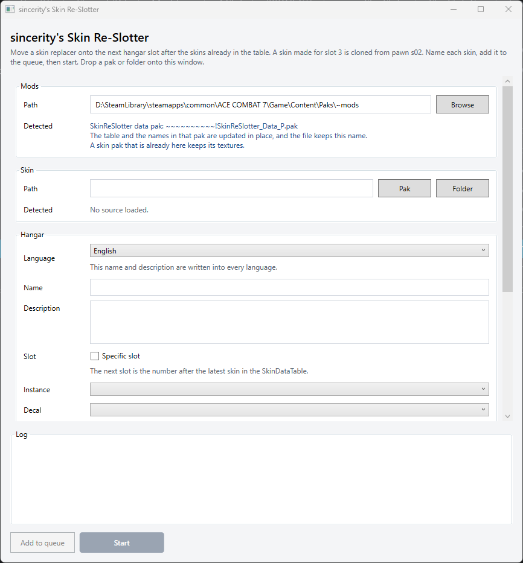
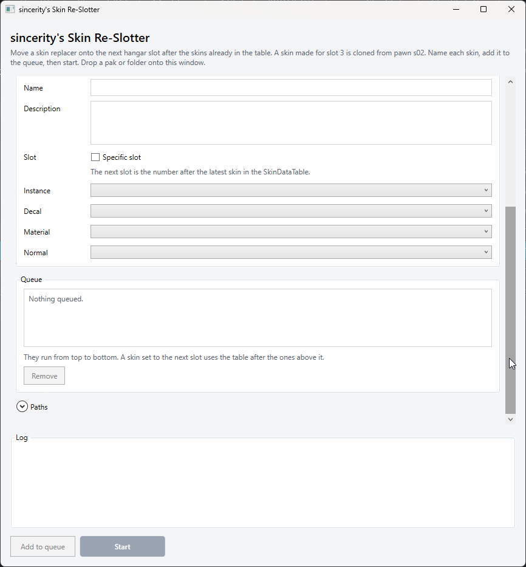
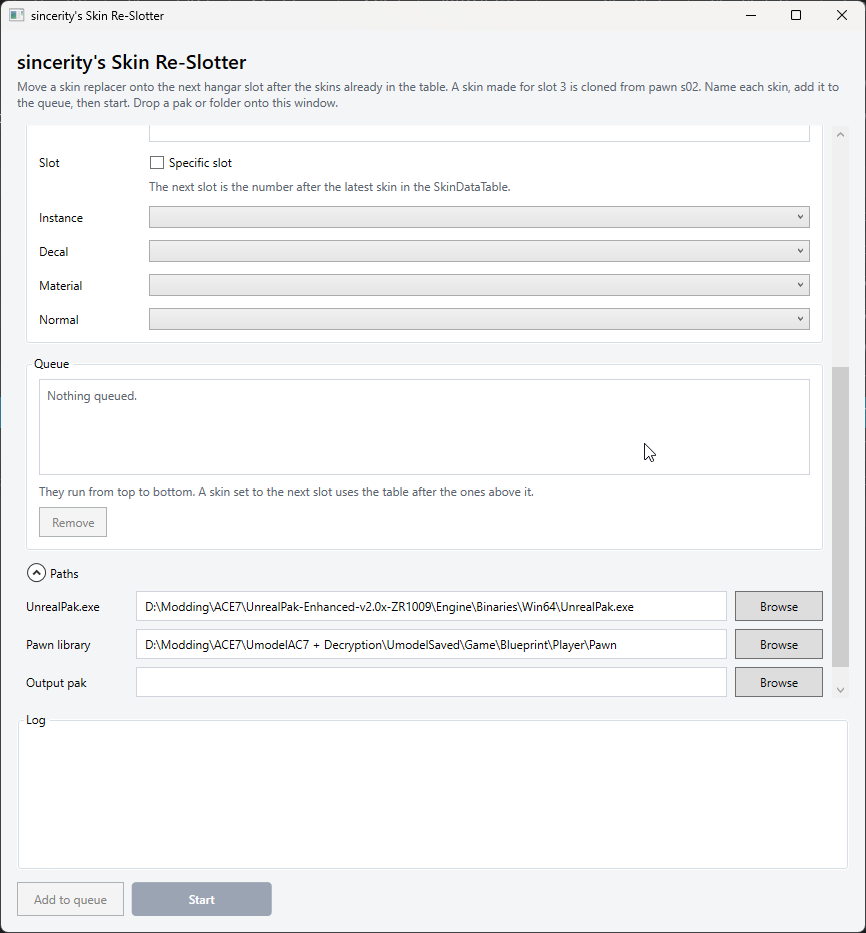

# sincerity's Skin Re-Slotter

sincerity's Skin Re-Slotter turns an Ace Combat 7 skin-replacer pak into a new hangar line. It clones a skin pawn, adds a row to the skin data table, writes the hangar name and description, and packs the result with [UnrealPak Enhanced](https://www.moddb.com/downloads/unrealpak-enhanced).

## Disclaimer

This program was written with an AI coding assistant. Treat the output as unreviewed until you have checked it. Read a generated pak in UAssetGUI, and fly the skin in-game, before you share it.

Unless you are the author of the skin mod you are re-slotting, you are generally not allowed to publish the result.

Ace Combat 7 and its files belong to their owners. This repository does not include the game's data table, localization, pawns, or textures. Export those from a copy of the game you own, and keep that export on your own machine.

## Requirements

- Windows
- [Ace Combat 7: Skies Unknown](https://store.steampowered.com/app/502500/ACE_COMBAT_7_SKIES_UNKNOWN/)
- [.NET 8](https://dotnet.microsoft.com/download/dotnet/8.0) (the desktop runtime to run the window, the SDK to build)
- **[(AC7/UE4) UnrealPak Enhanced](https://www.moddb.com/downloads/unrealpak-enhanced)**, by Rythus (VDG_Rythus). The tool packs and unpacks with `UnrealPak.exe` from that download. Point **Paths → UnrealPak.exe** at it.

## How to use

1. Set **Mods** to your `~mods` folder, **UnrealPak.exe** to where you unpacked UnrealPak Enhanced, with its **UnrealPak.exe** located in `(unpacked archive)\Engine\Binaries\Win64\UnrealPak.exe`, and **Pawn library** to your `Pawn` folder.
2. Drop a skin pak, or browse to it. The detected block shows the plane, the source slot, and what the pak contains.
3. Type a name and description. Switch **Language** only when a translation should differ from English.
4. Leave the slot on the next free number, or tick **Specific slot**. Stock slots already in the table cannot be overwritten.
5. Choose the instance, decal, material, and normal.
6. **Add to queue** for several skins, then **Start**.

Close the program before you replace `SkinSlotsGui.exe`. A running window keeps the old build loaded.

Settings are stored in `%AppData%\since_SkinSlots\gui.json`. The name and description start empty each launch.

## Screenshots

The mods folder, the skin pak, and the hangar language, name, and description.



The name, description, slot, material choices, and the queue.



The paths and the log.



## How it works

A skin replacer overwrites a slot the game already has. This tool copies that skin onto a new hangar line.

The hangar number is one higher than the folder and the pawn. Slot 3 uses folder `02` and pawn `s02`. Slot 13 uses folder `12` and pawn `s12`. A skin made for slot 1 keeps the slot `00` textures and instances, and uses pawn `s03`.

Each run puts two paks in `~mods`. One holds the pawn and the textures. The other holds the skin list and the names, so the new line shows up in the hangar. If a skin pak with the same name is already there, its textures are left as they are.

The tool also looks through `~mods` for SkinDataTable or localization that an add-on or another mod already installed. When it finds one, it adds the new skin on top of that list, so those mods can stay enabled.

The English name and description are copied into every language. The queue runs from top to bottom.

## Command line

```text
dotnet SkinSlotsCli\bin\Release\net8.0\SkinSlotsCli.dll <skin.pak or folder> ^
  --unrealpak <UnrealPak.exe> ^
  --mods <~mods folder> ^
  --pawns <...\Game\Blueprint\Player\Pawn> ^
  --name Serdyukov ^
  --description "Hangar text" ^
  --slot 13
```

`--slot` is the hangar number. Leave it out to use the next free slot. `--output` sets the skin pak path and rebuilds it even when a matching pak is already in `~mods`.

## Building

Install the [.NET 8 SDK](https://dotnet.microsoft.com/download/dotnet/8.0), then from this folder:

```text
dotnet build since_SkinSlots.sln -c Release
```

- Window: `SkinSlotsGui\bin\Release\net8.0-windows\SkinSlotsGui.exe`
- Command line: `SkinSlotsCli\bin\Release\net8.0\SkinSlotsCli.dll`

The check below clones a stock F-16C pawn and reads the saved table. Point `--pawns` at your pawn library:

```text
dotnet SkinSlotsCli\bin\Release\net8.0\SkinSlotsCli.dll --self-test --pawns <...\Game\Blueprint\Player\Pawn>
```

## Credits

- **[(AC7/UE4) UnrealPak Enhanced](https://www.moddb.com/downloads/unrealpak-enhanced)**, by Rythus (VDG_Rythus). It packs and unpacks the paks. Rythus built this enhanced version on FluffyQuack's standalone UnrealPak and the Unreal Engine 4.18 binary. The page credits Epic Games for the original binaries and FluffyQuack for the original batch scripts.
- **[UAssetAPI](https://github.com/atenfyr/UAssetAPI)** and **[UAssetGUI](https://github.com/atenfyr/UAssetGUI)**, by Atenfyr. The tool reads and writes Unreal assets with UAssetAPI 1.1.0.
- **[Ace7 Localization Format](https://github.com/GreenTrafficLight/Ace7-Localization-Format)**, by GreenTrafficLight. The skin names and descriptions are written with it.
- The slot rewriting shared with the Ace Combat 7 skin converter.
- **[UModel](https://www.gildor.org/en/projects/umodel)**, by Gildor, for exporting the saved game files the pawn library is built from.
- **[Newtonsoft.Json](https://www.newtonsoft.com/json)**, by James Newton-King, used through UAssetAPI.
- Cursor, the AI coding assistant this program was written with. See the disclaimer above.
